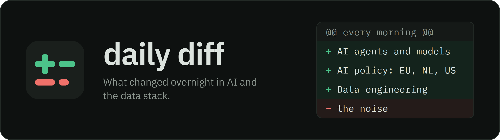

# Daily Diff

[](https://github.com/dboeter/daily-diff/actions/workflows/daily-digest.yml)
[](https://github.com/dboeter/daily-diff/actions/workflows/ci.yml)
[](https://dboeter.github.io/daily-diff/)
[](https://dboeter.github.io/daily-diff/feed.xml)
[](docs/reading.md#mcp-server)
[](LICENSE)

Daily Diff is a morning digest of what changed overnight in AI and the data stack. Every night it reads the release notes, lab announcements, legislative registers and community threads, and by about 05:00 Amsterdam time the day's pages are ready to read, one per topic.

The digest answers three questions: what changed since yesterday, what is coming up, and what is rising.

**[Read today's digest →](https://dboeter.github.io/daily-diff)**

## Why it exists

I'm a Dutch data engineer with an interest in AI: the coding agents, the models, and AI policy in the EU, the Netherlands and the US. These fields change every day, across dozens of changelogs, feeds and registers. Daily Diff reads them, so a person can read one report and know what matters for their work today.

A diff shows what changed and leaves the rest alone. The digest does the same: a page lists what is new since the last one, and a quiet day gives a short page.

## How it thinks

**A page is a topic.** Agents, models, policy and data engineering each have a page. A story goes to the page of its topic, whether it surfaced in a changelog, on Hacker News or in a government register.

**Tracked first, then Spotted.** A daily page starts with what it follows by name. For a project that is its releases, the issues that drew the most reactions that day and the news about it. For a lab, a vendor or a legislature it is what they published. The agents, models and data pages then add Spotted, the best community stories on their topic. The tracked list is a deliberate choice. The weekly Trends page suggests candidates, and a person adds them.

**Every item is news once.** An item a page showed is settled. A bill or a vendor note returns when it reaches its next stage.

**Code states the facts, the model writes the prose.** Code decides what is new, ranks it and renders every table, so a date, a star count or a legal stage in a table comes straight from its source. The language model writes the summaries and the Highlights on top.

**Interpretation is marked.** The daily pages report. Interpretation of the week has two places: the Weekly Diff article, where every sentence of interpretation is in italics, and the Signals section of Trends.

**Every choice can be traced.** Each relevance judgment is saved next to the day's reports, with the answers behind it. When a story is on a page, or missing from it, the reason is on file, and a wrong verdict can be corrected by hand.

**It publishes when the run is sound.** The run builds every page first and publishes only when the language model answered well enough. On a bad night yesterday's digest stays up, and the day can be run again by hand.

**Plain Markdown, open archive.** Every day is a folder of Markdown files in this repository. The web UI, the RSS feeds, the GitHub Issues and the MCP server all serve those same files, and the daily run works on GitHub Actions, its prose written by a free model.

## What you get

| Page             | Cadence | In one line                                                                                   |
| ---------------- | ------- | --------------------------------------------------------------------------------------------- |
| AI Agents        | daily   | Releases, hot issues and news of the coding agents and agent tooling it tracks                |
| AI Models & Labs | daily   | New posts from Anthropic and OpenAI, newly listed models and stealth models                   |
| AI Policy        | daily   | New AI legislation, regulation and guidance in the EU, the Netherlands and the US, with dates |
| Data Engineering | daily   | Vendor changes that need action, release notes and the open-source data stack                 |
| Trends           | Mondays | What is rising: tools, models, papers and the week's most discussed stories                   |
| Weekly Diff      | Mondays | One article on what changed in the week and what it means                                     |

Each day also has an overview with every page's highlights and the dated items of the next 30 days. [Reports and sources](docs/reports.md) describes every page and where its data comes from.

## Quickstart

### Read it

- **Web**: [dboeter.github.io/daily-diff](https://dboeter.github.io/daily-diff)
- **RSS**: [feed.xml](https://dboeter.github.io/daily-diff/feed.xml), or one feed per page
- **In your AI client**, through the MCP server:

  ```bash
  claude mcp add --transport http daily-diff https://daily-diff-mcp.dboeter.workers.dev
  ```

[Reading the digest](docs/reading.md) has the details, and the Telegram and Teams notifications.

### Run your own

You need Node.js 22 and pnpm.

```bash
git clone https://github.com/dboeter/daily-diff.git
cd daily-diff
pnpm install
export GITHUB_TOKEN=ghp_xxxxx
export ANTHROPIC_API_KEY=sk-ant-xxxxx   # or another provider: see docs/configuration.md
pnpm start
```

The run writes today's reports under `digests/` and updates the state files there; [`CONTRIBUTING.md`](CONTRIBUTING.md#set-up) has the commands that undo it. To make it your own digest, edit `config.yml`: it lists the tracked projects, feeds and watchlists. [Configuration and running](docs/configuration.md) covers the providers, the optional keys and the nightly schedule.

## What it tracks

The projects Daily Diff follows by name. The lists live in `config.yml`, and a pull request that proposes a project is welcome.

<details>
<summary>AI agents and agent tooling</summary>

<!-- tracked:agents -->
<!-- generated from config.yml: edit config.yml, then run pnpm readme -->

**Coding agents & assistants**: AI coding agents and personal AI assistants.

| Project          | Repository                                                                      |
| ---------------- | ------------------------------------------------------------------------------- |
| Claude Code      | [anthropics/claude-code](https://github.com/anthropics/claude-code)             |
| OpenAI Codex     | [openai/codex](https://github.com/openai/codex)                                 |
| Gemini CLI       | [google-gemini/gemini-cli](https://github.com/google-gemini/gemini-cli)         |
| Kilo Code        | [Kilo-Org/kilocode](https://github.com/Kilo-Org/kilocode)                       |
| OpenCode         | [anomalyco/opencode](https://github.com/anomalyco/opencode)                     |
| Pi               | [earendil-works/pi](https://github.com/earendil-works/pi)                       |
| Oh My Pi         | [can1357/oh-my-pi](https://github.com/can1357/oh-my-pi)                         |
| jcode            | [1jehuang/jcode](https://github.com/1jehuang/jcode)                             |
| Cline            | [cline/cline](https://github.com/cline/cline)                                   |
| Command Code     | [CommandCodeAI/command-code](https://github.com/CommandCodeAI/command-code)     |
| DeepSeek Harness | [deepseek-ai/deepseek-harness](https://github.com/deepseek-ai/deepseek-harness) |
| Hermes Agent     | [nousresearch/hermes-agent](https://github.com/nousresearch/hermes-agent)       |

<!-- /tracked:agents -->

<!-- tracked:infra -->
<!-- generated from config.yml: edit config.yml, then run pnpm readme -->

**Agent tooling**: AI agent tooling — agent sandboxes, terminal session multiplexers and context-management tools.

| Project   | Repository                                                    |
| --------- | ------------------------------------------------------------- |
| OpenShell | [NVIDIA/OpenShell](https://github.com/NVIDIA/OpenShell)       |
| herdr     | [herdrdev/herdr](https://github.com/herdrdev/herdr)           |
| Conductor | [microsoft/conductor](https://github.com/microsoft/conductor) |

<!-- /tracked:infra -->

</details>

<details>
<summary>Data engineering</summary>

<!-- tracked:databricks -->
<!-- generated from config.yml: edit config.yml, then run pnpm readme -->

**Databricks**: Databricks and the open-source projects Databricks maintains (Delta Lake, Unity Catalog, MLflow, its CLI, Terraform provider and dbt adapter).

| Project                           | Repository                                                                                              |
| --------------------------------- | ------------------------------------------------------------------------------------------------------- |
| Delta Lake                        | [delta-io/delta](https://github.com/delta-io/delta)                                                     |
| delta-rs                          | [delta-io/delta-rs](https://github.com/delta-io/delta-rs)                                               |
| Unity Catalog                     | [unitycatalog/unitycatalog](https://github.com/unitycatalog/unitycatalog)                               |
| MLflow                            | [mlflow/mlflow](https://github.com/mlflow/mlflow)                                                       |
| Databricks CLI                    | [databricks/cli](https://github.com/databricks/cli)                                                     |
| dbt-databricks                    | [databricks/dbt-databricks](https://github.com/databricks/dbt-databricks)                               |
| Terraform provider for Databricks | [databricks/terraform-provider-databricks](https://github.com/databricks/terraform-provider-databricks) |

<!-- /tracked:databricks -->

<!-- tracked:snowflake -->
<!-- generated from config.yml: edit config.yml, then run pnpm readme -->

**Snowflake**: Snowflake's open-source clients, its Terraform provider and the Apache Polaris catalog Snowflake maintains.

| Project                          | Repository                                                                                              |
| -------------------------------- | ------------------------------------------------------------------------------------------------------- |
| Snowpark Python                  | [snowflakedb/snowpark-python](https://github.com/snowflakedb/snowpark-python)                           |
| Snowflake Connector for Python   | [snowflakedb/snowflake-connector-python](https://github.com/snowflakedb/snowflake-connector-python)     |
| Apache Polaris                   | [apache/polaris](https://github.com/apache/polaris)                                                     |
| Terraform provider for Snowflake | [snowflakedb/terraform-provider-snowflake](https://github.com/snowflakedb/terraform-provider-snowflake) |

<!-- /tracked:snowflake -->

<!-- tracked:data_stack -->
<!-- generated from config.yml: edit config.yml, then run pnpm readme -->

**Open-source data stack**: open-source data engineering tools — transformation, orchestration, ingestion, table formats, query engines, data quality, lineage and metadata catalogs.

| Project            | Repository                                                                                        |
| ------------------ | ------------------------------------------------------------------------------------------------- |
| dbt Core           | [dbt-labs/dbt](https://github.com/dbt-labs/dbt)                                                   |
| SQLMesh            | [SQLMesh/sqlmesh](https://github.com/SQLMesh/sqlmesh)                                             |
| Apache Airflow     | [apache/airflow](https://github.com/apache/airflow)                                               |
| Dagster            | [dagster-io/dagster](https://github.com/dagster-io/dagster)                                       |
| Prefect            | [PrefectHQ/prefect](https://github.com/PrefectHQ/prefect)                                         |
| dlt                | [dlt-hub/dlt](https://github.com/dlt-hub/dlt)                                                     |
| Apache Iceberg     | [apache/iceberg](https://github.com/apache/iceberg)                                               |
| PyIceberg          | [apache/iceberg-python](https://github.com/apache/iceberg-python)                                 |
| DuckDB             | [duckdb/duckdb](https://github.com/duckdb/duckdb)                                                 |
| Polars             | [pola-rs/polars](https://github.com/pola-rs/polars)                                               |
| Trino              | [trinodb/trino](https://github.com/trinodb/trino)                                                 |
| Great Expectations | [great-expectations/great_expectations](https://github.com/great-expectations/great_expectations) |
| Soda Core          | [sodadata/soda-core](https://github.com/sodadata/soda-core)                                       |
| OpenLineage        | [OpenLineage/OpenLineage](https://github.com/OpenLineage/OpenLineage)                             |
| OpenMetadata       | [open-metadata/OpenMetadata](https://github.com/open-metadata/OpenMetadata)                       |

<!-- /tracked:data_stack -->

</details>

## Documentation

- [Reports and sources](docs/reports.md): every page, how a project is covered, the data sources, the archive
- [Reading the digest](docs/reading.md): web UI, RSS, MCP server, Telegram and Teams
- [Configuration and running](docs/configuration.md): `config.yml`, keys, LLM providers, local runs, the schedule
- [`AGENTS.md`](AGENTS.md): the pipeline, the state files and the reasons behind the design
- [`GLOSSARY.md`](GLOSSARY.md): the project's terms
- [`CODING_STANDARDS.md`](CODING_STANDARDS.md): how the code is written

## Contributing

Contributions are welcome: a project worth tracking, a source the digest should read, a fix. Daily Diff has one maintainer, so a short pull request with a clear reason is the easiest to review. [`CONTRIBUTING.md`](CONTRIBUTING.md) has the setup and the checks. Everyone who takes part follows the [code of conduct](CODE_OF_CONDUCT.md), and security problems go through the [security policy](SECURITY.md).

## License

[MIT](LICENSE)
