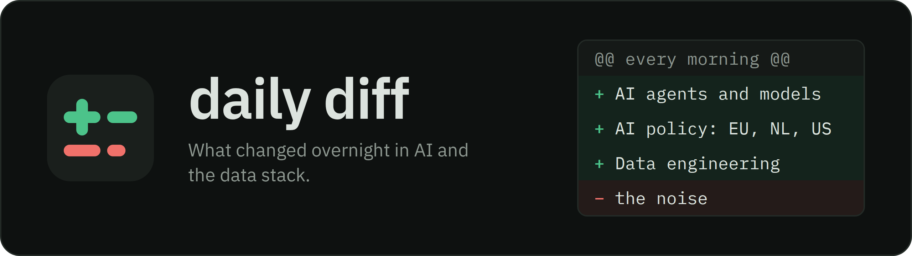

# Daily Diff

[](https://github.com/dboeter/daily-diff/actions/workflows/daily-digest.yml)
[](https://github.com/dboeter/daily-diff/actions/workflows/ci.yml)
[](https://dboeter.github.io/daily-diff/)
[](https://dboeter.github.io/daily-diff/feed.xml)
[](#mcp-server)
[](LICENSE)

A personal daily digest of AI coding agents, AI models, AI policy and the data engineering stack. A GitHub Actions workflow runs every night, collects from the [data sources](#data-sources) below and publishes English reports as GitHub Issues and Markdown files in [`digests/`](./digests/), by about 05:00 Amsterdam time. Read them in the [Web UI](#web-ui), the [RSS feed](#rss-feed) or the [MCP server](#mcp-server).

## Reports

| File           | Report           | Cadence | Content                                                                                                                                                                |
| -------------- | ---------------- | ------- | ---------------------------------------------------------------------------------------------------------------------------------------------------------------------- |
| `ai-agents.md` | AI Agents        | daily   | Releases, hot issues and news of the tracked agents and agent tooling, then Spotted                                                                                    |
| `ai-models.md` | AI Models & Labs | daily   | New Anthropic and OpenAI posts, models newly listed on OpenRouter, stealth models, Spotted                                                                             |
| `ai-policy.md` | AI Policy        | daily   | New AI legislation, regulation and guidance for the EU, the Netherlands and the US, news & commentary, upcoming deadlines                                              |
| `ai-data.md`   | Data Engineering | daily   | Action required (deprecations with an end date), vendor release notes and repo releases for Databricks, Snowflake, Azure / Fabric & GCP and the open-source data stack |
| `ai-trends.md` | Trends           | Mondays | Trending agents & coding tools, the week's Claude Code Skills PRs and requests, candidates to track, OpenRouter and Hugging Face models, the week's top papers and most discussed stories, Signals |

Every report opens with **Highlights**, then its tracked sections. AI Agents, AI Models & Labs and Data Engineering add **Spotted**: community stories on their topic that named no tracked project; Trends ends with **Signals**. A daily report with nothing new is skipped (AI Agents is always written). Each day also writes `highlights.json` (up to 2 highlights per report) and `coming-up.json` (dated items of the next 30 days from every page), which the Web UI's day overview and the notifications show, and `talked-about.json` (the day's best stories on topics without a page, the overview's "Also talked about" list).

Code decides what is new and renders the tables; the LLM writes the prose: the per-project sections, row summaries, Highlights and Signals. Relevance, topic and category judgments come from [Jev](https://typesafe.ai) (TypeSafe), with keyword rules as the fallback without `TYPESAFE_API_KEY`. Each verdict is cached in a committed file under `digests/` and asked once.

## Reading

### Web UI

**[dboeter.github.io/daily-diff](https://dboeter.github.io/daily-diff)** renders the Markdown files through GitHub Pages, in dark or light. Each day opens on an overview of every report's highlights and what is coming up; the latest Trends page stays pinned under **This week**.

### RSS feed

**[feed.xml](https://dboeter.github.io/daily-diff/feed.xml)** carries the latest 30 reports of every type. Each report also has its own feed, `feeds/<id>.xml` (e.g. [`feeds/ai-data.xml`](https://dboeter.github.io/daily-diff/feeds/ai-data.xml) for Data Engineering alone).

### MCP server

**`https://daily-diff-mcp.dboeter.workers.dev`** is a [Model Context Protocol](https://modelcontextprotocol.io) server (a Cloudflare Worker in `mcp/`) that reads the reports from GitHub Pages. Add it to any client as an HTTP MCP server, e.g. `claude mcp add --transport http daily-diff https://daily-diff-mcp.dboeter.workers.dev`.

| Tool           | Description                                         |
| -------------- | --------------------------------------------------- |
| `list_reports` | List available dates and report types (last N days) |
| `get_latest`   | Fetch the most recent report of a given type        |
| `get_report`   | Fetch a specific report by date and type            |
| `search`       | Keyword search across recent reports                |

The `Deploy MCP` workflow deploys it on pushes to `main` that touch `mcp/`; new digests need no deploy. By hand: `cd mcp && pnpm install && pnpm run deploy` (not `pnpm deploy`, which is pnpm's workspace command).

### Telegram and Teams

With `TELEGRAM_BOT_TOKEN` and `TELEGRAM_CHAT_ID` set, each run sends a Telegram message linking every report with its highlights, then up to 5 Coming up items. With `TEAMS_WEBHOOK_URL` set, the Data Engineering highlights go to a Teams channel as an Adaptive Card. Either one unset is skipped silently.

## Data sources

| Source                                                                                                                                                                                                                                                                                                                                                           | Used for                                                                                                                                  |
| ---------------------------------------------------------------------------------------------------------------------------------------------------------------------------------------------------------------------------------------------------------------------------------------------------------------------------------------------------------------- | ----------------------------------------------------------------------------------------------------------------------------------------- |
| [GitHub](https://github.com) API                                                                                                                                                                                                                                                                                                                                 | Stable releases and hot issues of the [tracked repos](#tracked-repos); [anthropics/skills](https://github.com/anthropics/skills) (weekly) |
| [GitHub Trending](https://github.com/trending) + Search API, [OpenRouter](https://openrouter.ai/apps) apps, [npm](https://www.npmjs.com) registry                                                                                                                                                                                                                | Trends' agents & coding tools (weekly); github.com/trending is also fetched daily for project news                                        |
| [Hacker News](https://github.com/HackerNews/API), [Lobste.rs](https://lobste.rs) (`ai`, `vibecoding`, `databases`), [Dev.to](https://dev.to) (15+ reactions)                                                                                                                                                                                                     | Project news and Spotted, each story shown once; Trends' Most discussed                                                                   |
| [Anthropic](https://www.anthropic.com) and [OpenAI](https://openai.com) sitemaps                                                                                                                                                                                                                                                                                 | Lab announcements: a post is new when its URL is                                                                                          |
| [OpenRouter](https://openrouter.ai) models API and rankings, [Hugging Face](https://huggingface.co) Hub API                                                                                                                                                                                                                                                      | New and stealth models (daily); token usage and trending models (weekly)                                                                  |
| [ArXiv](https://arxiv.org) API (cs.AI, cs.CL, cs.LG)                                                                                                                                                                                                                                                                                                             | Papers ranked daily by Jev; the week's top 10 in Trends                                                                                   |
| EU: [Commission](https://digital-strategy.ec.europa.eu) and [EDPB](https://www.edpb.europa.eu) RSS, the Commission's digital-strategy mailing (via [AgentMail](https://agentmail.to)), [EUR-Lex](https://eur-lex.europa.eu) SPARQL, [European Parliament](https://data.europarl.europa.eu) API, [Have your say](https://ec.europa.eu/info/law/better-regulation) | AI Policy: acts, procedures and consultations, with their stage                                                                           |
| NL: [Tweede Kamer](https://opendata.tweedekamer.nl) OData + KOOP SRU, [Internetconsultatie](https://www.internetconsultatie.nl), AP, Rijksoverheid, RDI and Digitale Overheid RSS                                                                                                                                                                                | AI Policy: motions, letters, watchlisted bills, consultations, government news                                                            |
| US: [Federal Register](https://www.federalregister.gov/developers/documentation/api/v1), [Regulations.gov](https://open.gsa.gov/api/regulationsgov/) and [Congress.gov](https://api.congress.gov) (`USA_GOV_API_KEY`), [Open States](https://v3.openstates.org/docs) (`PLURAL_API_KEY`)                                                                          | AI Policy: rules, notices, federal and state bills from passing a chamber onward                                                          |
| Policy news RSS (`kind: news` in `config.yml`): Politico Europe and US, Transformer, CSET, Covington, Binnenlands Bestuur                                                                                                                                                                                                                                        | AI Policy's News & commentary                                                                                                             |
| Vendor release notes (`data.feeds` in `config.yml`): Azure Databricks, Microsoft Fabric, Azure updates, Snowflake release notes and behavior changes, BigQuery                                                                                                                                                                                                   | Data Engineering's vendor tables and Action required                                                                                      |

## Tracked repos

Each tracked repo is covered by its stable releases of the last 24h (prereleases are only counted, unless the project has never shipped a stable release), hot issues (open, however old, with activity in the last 24h and 10+ comments and 👍, 3+ when labelled regression or security; at most 2; each is shown once) and news (a community story or its own GitHub Trending entry naming it; a story naming three or more agents is a compatibility list and skipped). Projects with none of these are listed in one "Quiet today" line. Only the repos below are tracked: trending repos are suggested under the Trends page's Candidates to track, never added automatically.

### AI Agents

<!-- tracked:agents -->
<!-- generated from config.yml: edit config.yml, then run pnpm readme -->

**Coding Agents & Assistants**: AI coding agents and personal AI assistants.

| Project          | Repository                                                                      |
| ---------------- | ------------------------------------------------------------------------------- |
| Claude Code      | [anthropics/claude-code](https://github.com/anthropics/claude-code)             |
| OpenAI Codex     | [openai/codex](https://github.com/openai/codex)                                 |
| Gemini CLI       | [google-gemini/gemini-cli](https://github.com/google-gemini/gemini-cli)         |
| Kilo Code        | [Kilo-Org/kilocode](https://github.com/Kilo-Org/kilocode)                       |
| OpenCode         | [anomalyco/opencode](https://github.com/anomalyco/opencode)                     |
| Pi               | [earendil-works/pi](https://github.com/earendil-works/pi)                       |
| Oh My Pi         | [can1357/oh-my-pi](https://github.com/can1357/oh-my-pi)                         |
| jcode            | [1jehuang/jcode](https://github.com/1jehuang/jcode)                             |
| Cline            | [cline/cline](https://github.com/cline/cline)                                   |
| Command Code     | [CommandCodeAI/command-code](https://github.com/CommandCodeAI/command-code)     |
| DeepSeek Harness | [deepseek-ai/deepseek-harness](https://github.com/deepseek-ai/deepseek-harness) |
| Hermes Agent     | [nousresearch/hermes-agent](https://github.com/nousresearch/hermes-agent)       |

<!-- /tracked:agents -->

<!-- tracked:infra -->
<!-- generated from config.yml: edit config.yml, then run pnpm readme -->

**Agent Tooling**: AI agent tooling — agent sandboxes, terminal session multiplexers and context-management tools.

| Project      | Repository                                                              |
| ------------ | ----------------------------------------------------------------------- |
| OpenShell    | [NVIDIA/OpenShell](https://github.com/NVIDIA/OpenShell)                 |
| herdr        | [herdrdev/herdr](https://github.com/herdrdev/herdr)                     |
| context-mode | [mksglu/context-mode](https://github.com/mksglu/context-mode)           |
| Agent Deck   | [asheshgoplani/agent-deck](https://github.com/asheshgoplani/agent-deck) |

<!-- /tracked:infra -->

### Data Engineering

The data repos are covered the same way, plus a **Releases this week** table of their stable releases of the last 7 days, each shown once.

<!-- tracked:databricks -->
<!-- generated from config.yml: edit config.yml, then run pnpm readme -->

**Databricks**: Databricks and the open-source projects Databricks maintains (Delta Lake, Unity Catalog, MLflow, its CLI and dbt adapter).

| Project        | Repository                                                                |
| -------------- | ------------------------------------------------------------------------- |
| Delta Lake     | [delta-io/delta](https://github.com/delta-io/delta)                       |
| Unity Catalog  | [unitycatalog/unitycatalog](https://github.com/unitycatalog/unitycatalog) |
| MLflow         | [mlflow/mlflow](https://github.com/mlflow/mlflow)                         |
| Databricks CLI | [databricks/cli](https://github.com/databricks/cli)                       |
| dbt-databricks | [databricks/dbt-databricks](https://github.com/databricks/dbt-databricks) |

<!-- /tracked:databricks -->

<!-- tracked:snowflake -->
<!-- generated from config.yml: edit config.yml, then run pnpm readme -->

**Snowflake**: Snowflake's open-source clients and the Apache Polaris catalog Snowflake maintains.

| Project                        | Repository                                                                                          |
| ------------------------------ | --------------------------------------------------------------------------------------------------- |
| Snowpark Python                | [snowflakedb/snowpark-python](https://github.com/snowflakedb/snowpark-python)                       |
| Snowflake Connector for Python | [snowflakedb/snowflake-connector-python](https://github.com/snowflakedb/snowflake-connector-python) |
| Apache Polaris                 | [apache/polaris](https://github.com/apache/polaris)                                                 |

<!-- /tracked:snowflake -->

<!-- tracked:data_stack -->
<!-- generated from config.yml: edit config.yml, then run pnpm readme -->

**Open-source data stack**: open-source data engineering tools — transformation, orchestration, ingestion, table formats and query engines.

| Project        | Repository                                                  |
| -------------- | ----------------------------------------------------------- |
| dbt Core       | [dbt-labs/dbt](https://github.com/dbt-labs/dbt)             |
| SQLMesh        | [SQLMesh/sqlmesh](https://github.com/SQLMesh/sqlmesh)       |
| Apache Airflow | [apache/airflow](https://github.com/apache/airflow)         |
| Dagster        | [dagster-io/dagster](https://github.com/dagster-io/dagster) |
| dlt            | [dlt-hub/dlt](https://github.com/dlt-hub/dlt)               |
| Apache Iceberg | [apache/iceberg](https://github.com/apache/iceberg)         |
| DuckDB         | [duckdb/duckdb](https://github.com/duckdb/duckdb)           |
| Polars         | [pola-rs/polars](https://github.com/pola-rs/polars)         |
| Trino          | [trinodb/trino](https://github.com/trinodb/trino)           |

<!-- /tracked:data_stack -->

## Configuration

`config.yml` (fully commented) holds the tracked repos, the AI Policy sources, watchlists and calendar, and the vendor feeds; the pipeline stops with an error when a section is missing. After editing it, run `pnpm readme` to refresh the tables above; pre-commit and CI fail while they are stale.

```yaml
agents:
  repos:
    - id: my-agent
      repo: owner/my-agent
      name: My Agent
      keywords: [my agent] # optional: news match terms; defaults to name + repo name
```

### Secrets

Repository secrets (**Settings → Secrets and variables → Actions**); `GITHUB_TOKEN` is provided by Actions.

| Secret                                   | Description                                                                                                                                              |
| ---------------------------------------- | -------------------------------------------------------------------------------------------------------------------------------------------------------- |
| `OPENROUTER_API_KEY`                     | The scheduled run's LLM key (the workflow sets `LLM_PROVIDER: openrouter`; for another provider, edit the workflow, see [LLM providers](#llm-providers)) |
| `TYPESAFE_API_KEY`                       | Jev judgments (without it: keyword rules, search-topic labels, and no Research section in Trends)                                                        |
| `USA_GOV_API_KEY`                        | [api.data.gov](https://api.data.gov/signup/) key for Congress.gov and Regulations.gov                                                                    |
| `PLURAL_API_KEY`                         | [Open States](https://open.pluralpolicy.com) key for US state bills                                                                                      |
| `TELEGRAM_BOT_TOKEN`, `TELEGRAM_CHAT_ID` | Telegram notifications (bot from [@BotFather](https://t.me/BotFather))                                                                                   |
| `TEAMS_WEBHOOK_URL`                      | Power Automate Workflows webhook for the Teams card                                                                                                      |
| `CLOUDFLARE_API_TOKEN`                   | The `Deploy MCP` workflow only                                                                                                                           |

A source whose key is unset is skipped; the rest of the run goes on.

### LLM providers

| Provider       | `LLM_PROVIDER`        | Key                  | Default model                 | Model override         |
| -------------- | --------------------- | -------------------- | ----------------------------- | ---------------------- |
| Anthropic      | `anthropic` (default) | `ANTHROPIC_API_KEY`  | `claude-sonnet-5-5`           | `ANTHROPIC_MODEL`      |
| OpenAI         | `openai`              | `OPENAI_API_KEY`     | `gpt-4o`                      | `OPENAI_MODEL`         |
| GitHub Copilot | `github-copilot`      | `GITHUB_TOKEN`       | `gpt-4o`                      | `GITHUB_COPILOT_MODEL` |
| OpenRouter     | `openrouter`          | `OPENROUTER_API_KEY` | `anthropic/claude-sonnet-5.5` | `OPENROUTER_MODEL`     |
| DeepSeek       | `deepseek`            | `DEEPSEEK_API_KEY`   | `deepseek-v4-flash`           | `DEEPSEEK_MODEL`       |
| Qwen           | `qwen`                | `DASHSCOPE_API_KEY`  | `qwen-flash`                  | `QWEN_MODEL`           |

`ANTHROPIC_BASE_URL`, `OPENAI_BASE_URL` and `DASHSCOPE_BASE_URL` override the endpoints. The scheduled run uses OpenRouter's free `nvidia/nemotron-3-super-120b-a12b:free` with `OPENROUTER_REASONING_EFFORT=low` (so reasoning does not eat the output budget) and `OPENROUTER_FALLBACK_MODELS` tried in order when it is down. When half the LLM calls fail, the run aborts before publishing anything.

### Running locally

```bash
pnpm install
export GITHUB_TOKEN=ghp_xxxxx
export ANTHROPIC_API_KEY=sk-ant-xxxxx   # or LLM_PROVIDER + its key
# export DIGEST_REPO=dboeter/daily-diff  # open GitHub Issues; omit to only write files
# export DIGEST_FORCE_WEEKLY=1           # also build the Trends page on a non-Monday
pnpm start
```

## Schedule

The workflow's cron is `7 1 * * *` in `Europe/Amsterdam`. GitHub starts scheduled runs 2.5–4 hours late, so the cron sits about 4 hours before the digest is wanted; if the delay changes, move it in `.github/workflows/daily-digest.yml`. Report dates and the Monday Trends run use CST (UTC+8), the same calendar day as Amsterdam at that hour.

**Actions → Daily Diff → Run workflow** starts a run by hand, e.g. to regenerate a day; tick **force_weekly** to build Trends too. A scheduled run skips a day whose `digests/YYYY-MM-DD` folder is already committed, so a late cron after a manual catch-up opens no duplicate issues.

## Archive

Every day is kept under [`digests/`](./digests/) and in the Web UI. Issues are labelled by report: [`agents`](../../issues?q=is%3Aissue+label%3Aagents) · [`models`](../../issues?q=is%3Aissue+label%3Amodels) · [`policy`](../../issues?q=is%3Aissue+label%3Apolicy) · [`data`](../../issues?q=is%3Aissue+label%3Adata) · [`trends`](../../issues?q=is%3Aissue+label%3Atrends). Each run closes the issues of earlier days (Trends stays open until the next Monday); issues without a digest label and pull requests are never touched.

Older days also hold reports retired or merged in October 2026 (`ai-cli`, `ai-ph`, `ai-infra`, `ai-community`, `ai-hn`, `ai-web`, `ai-trending`, `ai-hf`, `ai-arxiv`) and, until July 2026, weekly and monthly rollups.

## Star History

[](https://star-history.dera.page/#dboeter/daily-diff&Date)
